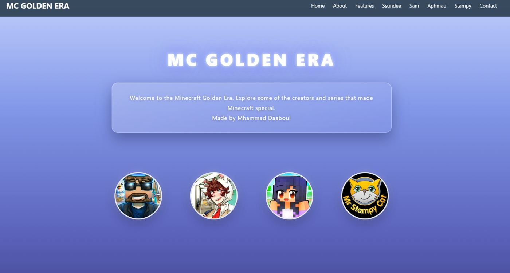
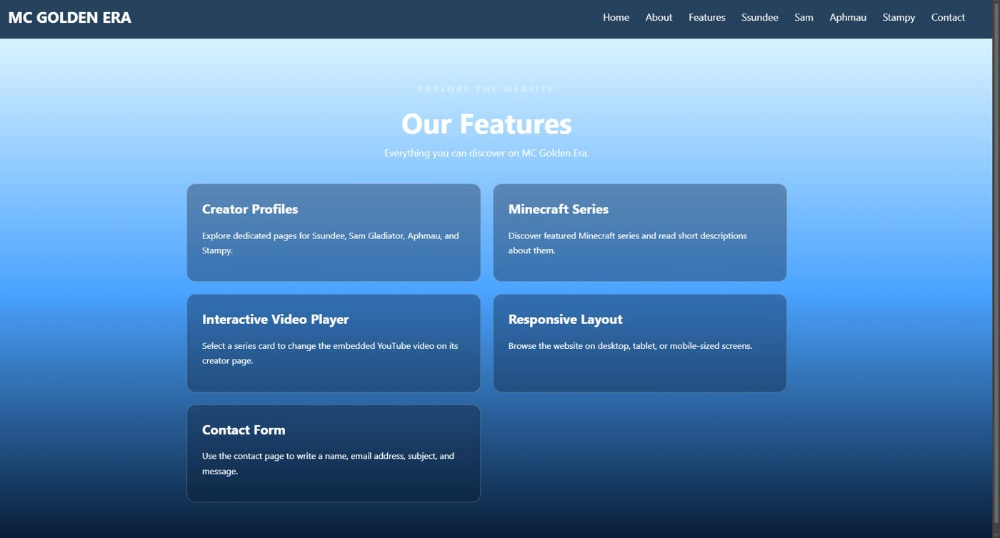
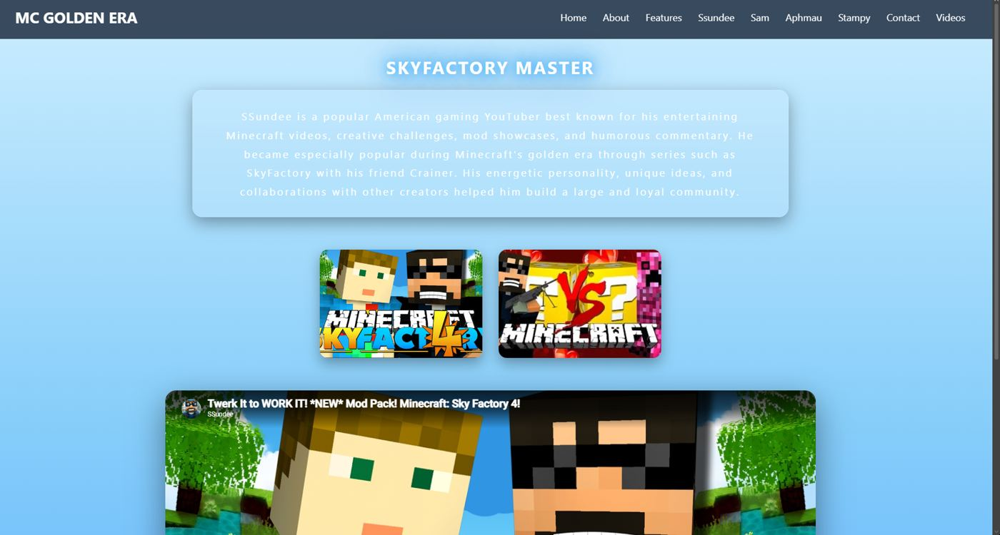
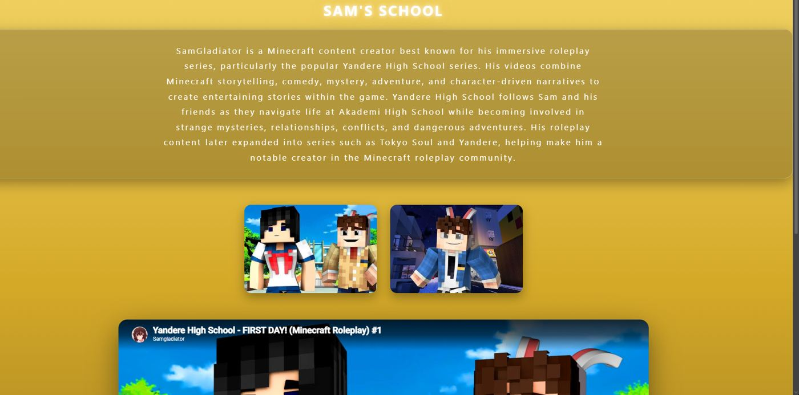
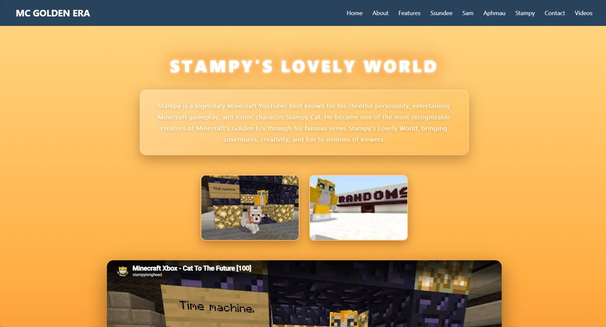
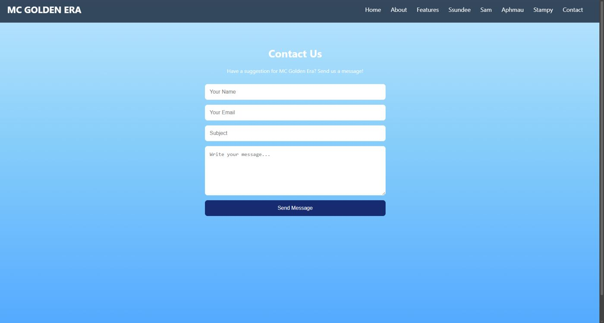

# MC Golden Era

A React-based fan website celebrating the Minecraft creators and series that made Minecraft's Golden Era memorable.

## Website preview

### Home


### About


### Features


### Creator pages

**Ssundee**



**Sam Gladiator**



**Stampy**



**Aphmau**


### Contact


## Pages and features

- **Home:** introduces MC Golden Era and highlights featured creators.
- **About:** explains the purpose and background of the fan-made project.
- **Features:** presents the main features available on the website.
- **Creator pages:** dedicated pages for Ssundee, Sam Gladiator, Aphmau, and Stampy, including creator information, series images, and embedded YouTube videos.
- **Interactive video player:** selecting a series card changes the embedded video on the creator page.
- **Contact:** a form interface where visitors can enter their name, email, subject, and message.

## Technologies

- React
- React Router
- JavaScript
- CSS
- YouTube embedded videos

## Run the project locally

1. Install [Node.js](https://nodejs.org/).
2. Clone this repository.
3. Open the project folder in a terminal.
4. Install the dependencies:

   ```bash
   npm install
   ```

5. Start the development server:

   ```bash
   npm start
   ```

6. Open [http://localhost:3000](http://localhost:3000) in your browser.

## Create a production build

Run:

```bash
npm run build
```

This creates an optimized production build in the `build` folder.

## Important notes

- The Contact form currently displays an on-screen confirmation in the browser. It does not send or store messages because a backend or form service has not been connected.
- The Videos navigation item opens the creator's external YouTube channel.
- This is a fan-made educational project and is not affiliated with the featured creators or Mojang.
